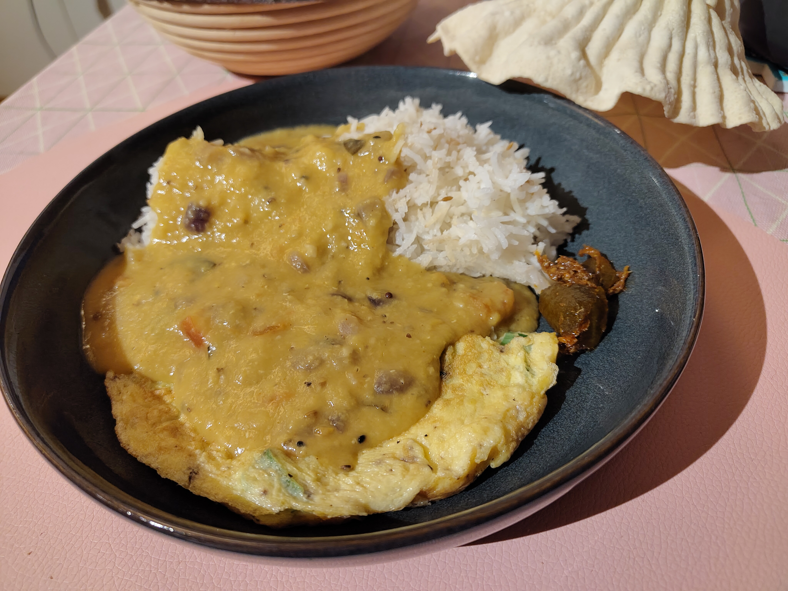

---
tags:
  - Indian
  - Curry
  - Vegetarian
---

# Daal Chawal

One of the favourite indian go-to recipe, which name literally translates to "lentils and rice".

---

**Ingredients** (3 portions)

- _Small orange lentils_ (1 cup)
- _Rice_ (1 cup) — preferably Basmati
- _Mustard oil_ (2 tbsp)
- _Ghee_ (1 tsp)
- _Green chilies_ (1~3)
- _Red onion_ (1 medium)
- _Garlic_ (2~3 cloves)
- _Tomato_ (1)

**Spices**

- _Curry leaves_
- _Cumin seeds_ (1/2 tsp)
- _Mustard seeds_ (1/2 tsp)
- _Curcuma_ (1/2 tsp)
- _Red chili powder_ (1/2 tsp) — Optional

---

**Steps**

1. Finely chop the _garlic_, _tomato_ and _onion_ (all in small cubes) and keep them in separate containers. Roughly chop the _green chilies_ too. Also wash the _daal_ (lentils). Cook the _rice_ separately at your liking.
2. In a pot add the _mustard oil_, _ghee_, _curry leaves_, _cumin seeds_ and the _mustard seeds_, all while the oil is still cold. Put the fire to medium-high heat and, when the seeds start sizzling, add the _chilies_, _garlic_ and _onion_.
3. When the onion has turn golden brown, add the _tomato_ along with some _salt_, _curcuma_ and some _red chili powder_. Let it cook on medium-heat for :clock: 10 minutes or until the tomatoes have completely soften.
4. Add the _lentils_ and let it cook for :clock: 30 ~ 40 minutes or for :clock: 10 minutes in a pressure-cook.
5. To serve add first the rice, then top it with the lentils.

!!! Tip
    You can also make an omelet to the side.
