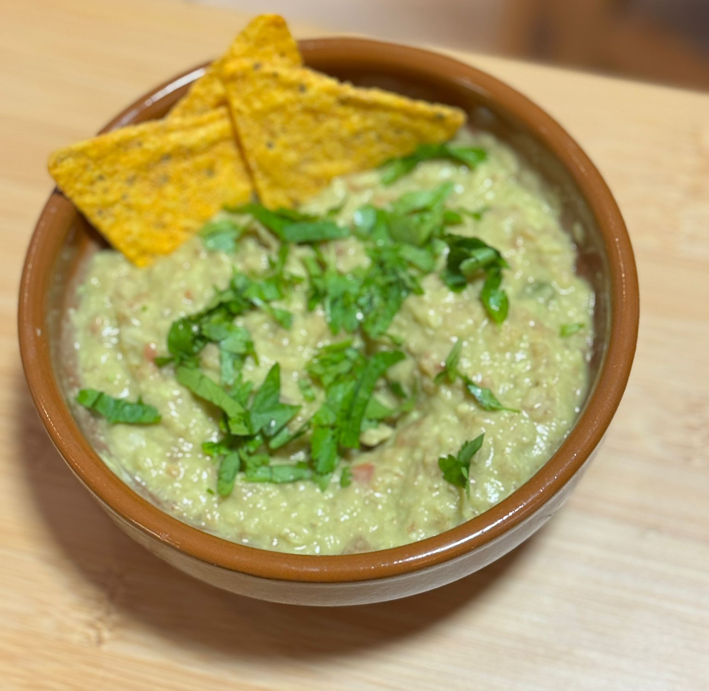

---
tags:
  - Mexican
  - Sauce
  - Vegetarian
---

# Guacamole

The guac is one of the most iconics sauces from Mexico.
This recipe might not be "truly original", but it is an easy and enjoyable recipe.
Having a food-processor will be of great help here.

---

**Ingredients**

- _Ripe avocados_ (2)
- _Tomato_ (1)
- _Onion_ (1) — Preferably red onion
- _Cumin powder_
- _Salt_
- _Lemon/lime juice_ (1/2 lemon) — Lime is better

---

**Steps**

1. Chop the _avocados_ and process them into almost a paste in the food processor.
2. Chop the _tomato_ and _onion_ roughly for it to fit in the food processor.
3. Add the juice and the _cumin powder_. Be generous with the cumin.
4. Process everything. The desired consistency is a paste-like where there are still some small chunks of tomato and onion.
